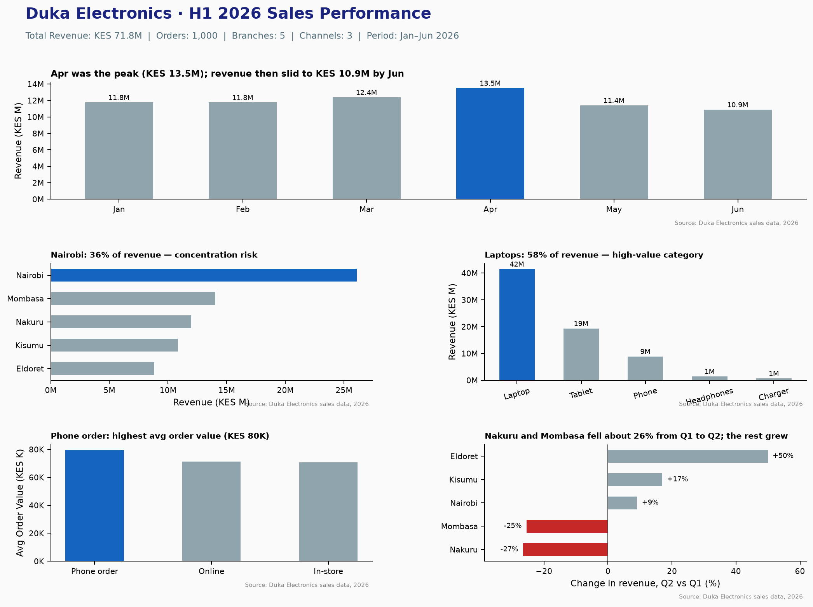

# plp-da-a4-student-eda-and-board-report

**PLP Data Analytics · Assignment 4 · Week 4**

---

## Repository Summary

This repository contains two end-to-end analyst engagements submitted as a single deliverable:

| Engagement                      | Client                       | Deliverable                                                                                                         |
| ------------------------------- | ---------------------------- | ------------------------------------------------------------------------------------------------------------------- |
| **1 · County Education Office** | County Director of Education | Exploratory Data Analysis report (`student_eda.ipynb`) identifying at-risk learners and factors driving performance |
| **2 · Duka Electronics Board**  | CEO / Board members          | One-page visual report (`board_report.ipynb` → `reports/duka_board_report.png`) and a live Looker Studio dashboard  |

---

## How to Run

### Prerequisites

```bash
# 1. Clone the repository
git clone https://github.com/<username>/plp-da-a4-student-eda-and-board-report
cd plp-da-a4-student-eda-and-board-report

# 2. Create and activate a virtual environment (recommended)
python -m venv .venv
# Windows:
.venv\Scripts\activate
# macOS/Linux:
source .venv/bin/activate

# 3. Install dependencies
pip install -r requirements.txt

# 4. (Optional) Regenerate the CSV datasets
python generate_data.py
```

### Run the Notebooks

Open each notebook in Jupyter Lab / Jupyter Notebook / VS Code and **restart the kernel, then run all cells from top to bottom**:

```bash
jupyter lab  # opens jupyter lab in the browser
```

```bash
jupyter notebook  # opens jupyter notebook in the browser
```

| Notebook             | Purpose                                         |
| -------------------- | ----------------------------------------------- |
| `student_eda.ipynb`  | Full EDA for Engagement 1                       |
| `board_report.ipynb` | Board report charts + makeover for Engagement 2 |

All outputs (charts, printed tables) are committed to the repository so reviewers can open the notebooks without running them.

---

## Five Key EDA Insights

1. **Study hours show the strongest link with scores (r = 0.70); attendance is weaker (r = 0.36).** Both are positive associations, not proof of cause.

2. **Each extra study hour is associated with about 2.1 more points (R² = 0.50).** Half the variation is unexplained, and the unit of `study_hours` is not stated (values reach 23.3, so we read it as hours per week).

3. **Private schools score about 5.6 points higher (76.0 vs 70.5), and the gap holds in every attendance band and study-hour quartile.** Public schools hold 94 of the 99 At Risk learners (95%); the data cannot say why.

4. **Only 8.2% of learners are At Risk, and no county stands out.** Nairobi is highest (9.2%) and Nakuru lowest (6.4%), but the difference is within chance (chi-square p = 0.92).

5. **Scores are roughly symmetric (mean 72.0, median 71.7).** 56% of learners are Meeting, 36% Exceeding and 8% At Risk; 29 learners (2.4%) are study-hour outliers and do not drive the results.

---

## Board Report — Duka Electronics H1 2026

The one-page board report is saved at:

```
reports/duka_board_report.png
```



---

## Board Summary

Duka Electronics earned KES 71.8 million from 1,000 orders in the first half of 2026. Nairobi brought in 36% of it, so the business leans heavily on one branch. Laptops are the engine: 58% of revenue from only 22% of orders. Revenue peaked in April at KES 13.5 million and slid to KES 10.9 million by June. Mombasa and Nakuru each earned about a quarter less in April–June than in January–March, while Nairobi, Kisumu and Eldoret grew. Online and in-store orders are worth about the same (roughly KES 71,000 each); phone orders are worth more (KES 80,000) but are only one order in ten. For the second half we recommend: a recovery plan for Mombasa and Nakuru, protecting laptop stock and promotions, and a trial of phone-order upselling. These figures cover January–June only, so April's peak may be a short swing rather than a seasonal pattern.

## Repository Structure

```
plp-da-a4-student-eda-and-board-report/
├── generate_data.py          # Synthetic data generators (seed 55 & 2026)
├── student_performance.csv   # 1,200-student dataset (Engagement 1)
├── duka_sales.csv            # 1,000-order dataset (Engagement 2)
├── student_eda.ipynb         # Full EDA notebook — Engagement 1
├── board_report.ipynb        # Board report notebook — Engagement 2
├── dashboard.md              # Looker Studio link + screenshots
├── requirements.txt          # Python dependencies
├── README.md                 # This file
├── figures/                  # Exported chart images
│   ├── score_hist.png
│   ├── county_bar.png
│   ├── school_boxplot.png
│   ├── trend_study_vs_score.png
│   ├── chart1_monthly_revenue.png
│   ├── chart2_branch_revenue.png
│   ├── chart3_product_revenue.png
│   ├── chart4_channel_revenue.png
│   ├── before.png
│   └── after.png
└── reports/
    └── duka_board_report.png  # One-page board report
```

---

## Libraries Used

- `pandas` — data manipulation and pivot tables
- `numpy` — numerical operations and `np.polyfit` trend line
- `matplotlib` — charting (histograms, bar charts, box plots, scatter plots)
- `seaborn` — correlation heatmap and styled visuals
- `scipy` — statistical tests (t-test, Pearson correlation)

---

_Submitted by: deendiran | PLP Data Analytics Cohort | November 2026_
