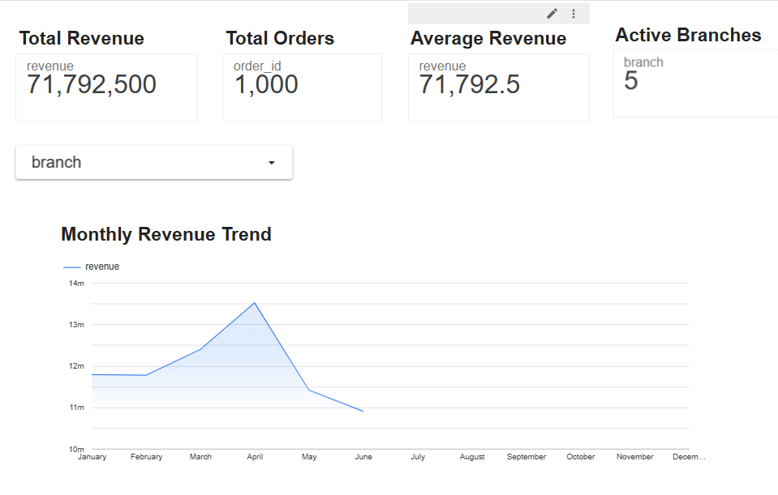
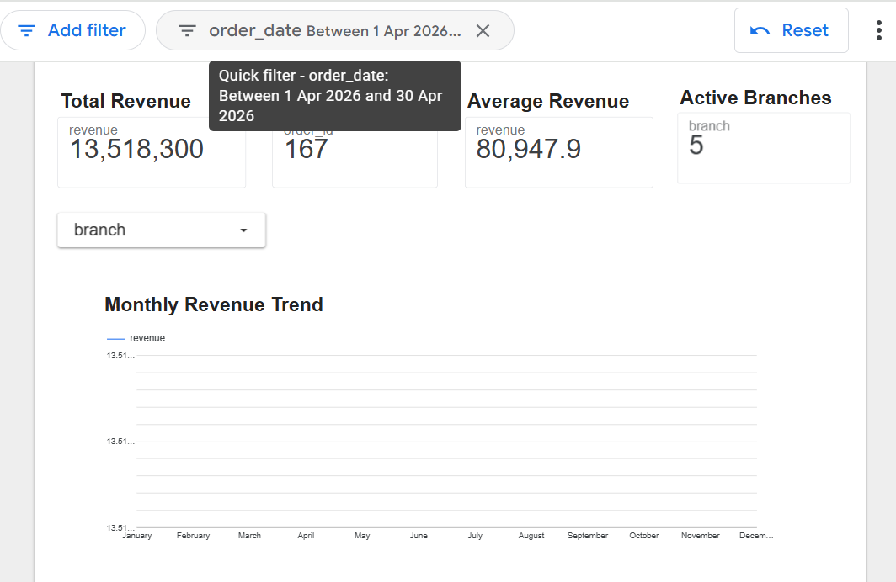
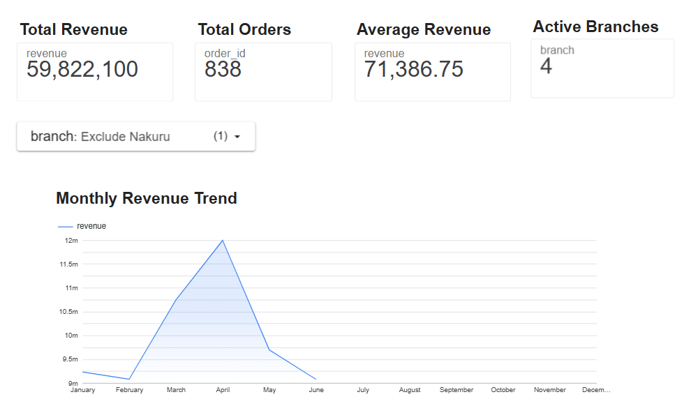
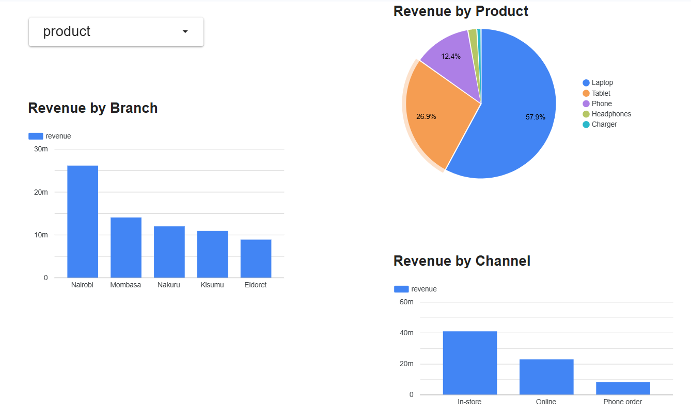

# Duka Electronics — Looker Studio Dashboard

## Public Dashboard Link

> **[Duka Electronics H1 2026 — Interactive Dashboard](https://lookerstudio.google.com/reporting/9a011499-fafa-40a0-a478-267952a91d84)**

---

## Dashboard Design

The dashboard was built from `duka_sales.csv` uploaded as a Google Sheets data source. It replicates and extends the one-page board report with live interactivity.

### Controls & Filters

| Control | Type | Purpose |
|---------|------|---------|
| **Date range** | Date Range Control | Filter any chart to a custom month window |
| **Branch** | Drop-down list | Isolate performance for a single branch |
| **Product** | Drop-down list | Drill into a specific product category |
| **Channel** | Drop-down list | Compare In-store vs Online vs Phone order |

---

## Screenshots

### Screenshot 1 — Overview Scorecards and Trend Line

- The screenshot shows the full view of the dashboard 
- The scorecard shows the total revenue for the selected period, total orders, avg revenue per order, and the number of active branches
- The line chart (Time series chart) shows the monthly revenue trend

- Date range for the above was from April 1st to April 30th

- For the branch control, I removed one of the branches (Nakuru)

**What is visible:**
- **Four scorecards** at the top: Total Revenue (KES), Total Orders, Avg Revenue (KES), and Number of Active Branches
- **Monthly Revenue Trend** (line + area chart) spanning January–June 2026 with the peak month highlighted
- **Date Range** filter control in the top-right corner
- **Branch** drop-down filter

---

### Screenshot 2 — Branch & Product Breakdowns with Filters Applied

**What is visible:**
- **Revenue by Branch** (horizontal bar chart) — Nairobi highlighted
- **Revenue by Product** (donut chart) — Laptop share clearly dominant
- **Revenue by Channel** (column chart) — In-store vs Online comparison
- Filters applied: Branch = **Nairobi**, Month = **March–June**
- Each chart shows the data restricted to the selected filter, demonstrating interactivity

---

## Data Source

| Field | Value |
|-------|-------|
| Source file | `duka_sales.csv` |
| Uploaded to | Google Sheets (linked as Looker Studio data source) |
| Rows | 1,000 orders |
| Date range | 2026-01-01 to 2026-06-29 |
| Calculated fields added | `revenue = quantity × unit_price`, `month_name`, `week_number` |

---

